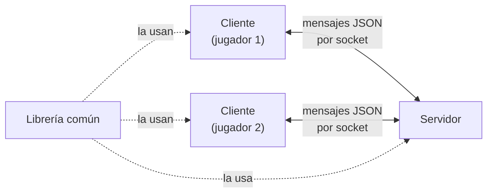
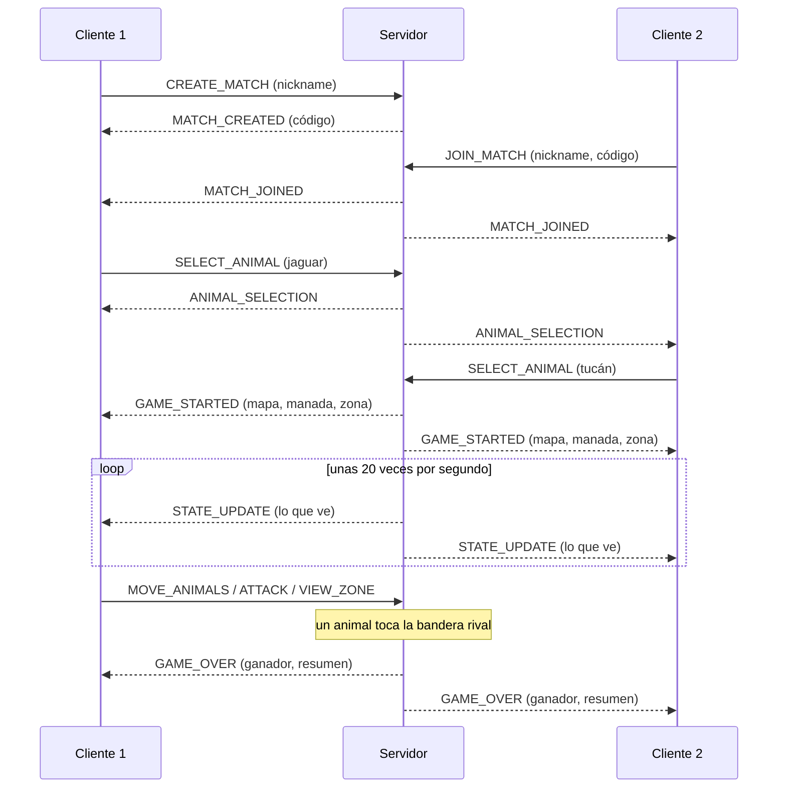
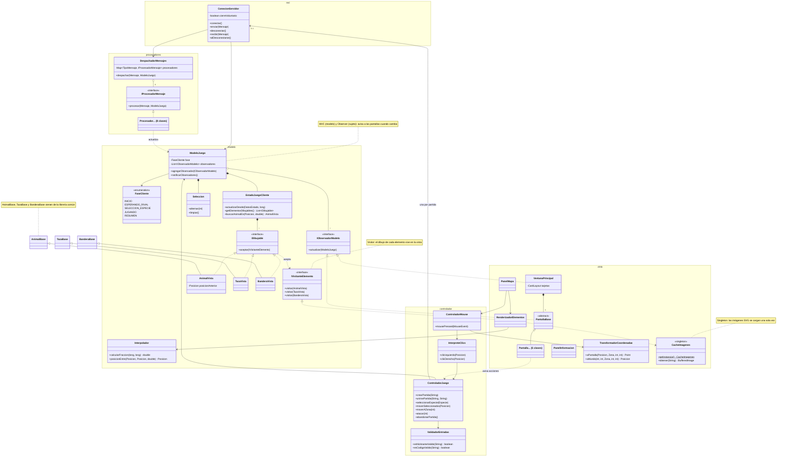

# Jungle Attack

Caso #2 de Programación Orientada a Objetos, Tecnológico de Costa Rica.

**Autores:** Ignacio Hernández Camacho y Julian Moya

*Jungle Attack* es un juego de batalla para dos jugadores, ambientado en un bosque de Costa Rica. Está construido como tres proyectos que trabajan juntos:

- **Este repositorio, el cliente:** la aplicación con ventana que usa cada jugador.
- **[El servidor](https://github.com/IgnacioHdzz/caso2-servidor-POO):** aplica las reglas y coordina las partidas.
- **[La librería común](https://github.com/IgnacioHdzz/caso2-comun-POO):** el protocolo de mensajes y las clases que comparten los otros dos.

Este README explica el juego y la arquitectura completa. Los otros dos explican el diseño de cada proyecto.

## El juego

Cada jugador elige una especie de animal de Costa Rica (jaguar, perezoso, tucán, mono carablanca, danta, rana calzonuda o cocodrilo) y recibe una manada de diez animales. El mapa es un bosque dividido en doce zonas, unidas por caminos. Además de las dos manadas de los jugadores, en el bosque viven cinco manadas de bots, una por cada especie que nadie eligió, que atacan a cualquier animal de un jugador que se les acerque.

Cada jugador tiene una bandera en la zona donde empezó. **Gana quien lleve uno de sus animales hasta la bandera del rival.** También se gana si el rival abandona la partida.

El bosque tiene niebla de guerra: cada jugador solo ve las zonas donde tiene animales. Para encontrar la bandera del rival hay que explorar, y en el camino aparecen bots y tazas de café. Cada taza que toca un animal aumenta en uno el daño de toda su manada, y cada dos bots eliminados, los animales vivos de la manada recuperan un punto de energía. Los animales solo pueden caminar por los caminos.

### Una partida, de principio a fin

1. **Inicio.** El jugador escribe su nickname. Si presiona **Crear**, el juego le muestra un código de cuatro caracteres para compartir con su rival. Si ya tiene un código, lo escribe y presiona **Unirse**.
2. **Esperando rival.** El creador espera a que alguien entre con su código.
3. **Selección de especie.** Cada jugador elige una especie. Las dos tienen que ser distintas.
4. **Juego.** Cada jugador maneja su manada hasta que alguien gana.
5. **Resumen.** Se muestra el ganador, la duración y las estadísticas de la partida. Desde ahí se puede volver al inicio y jugar otra.

### Controles

Todo se hace con el mouse. Con el **clic izquierdo** se seleccionan los animales propios: un clic sobre un animal lo selecciona o lo deselecciona, y un clic en un lugar vacío quita toda la selección. El botón **Seleccionar todos** selecciona todos los animales propios de la zona que se está viendo.

Con el **clic derecho** se dan las órdenes a los animales seleccionados. Sobre un enemigo, lo atacan. En un lugar vacío, caminan hasta el punto del camino más cercano. Para viajar a otra zona, se elige su número en **Ir a la zona** y se presiona **Mover seleccionados**: los animales van por la ruta más corta. Las zonas están numeradas de izquierda a derecha y de arriba hacia abajo, del 0 al 11.

Los botones de **Zona** muestran las zonas donde el jugador tiene animales, y permiten cambiar la que se está viendo. El botón **Abandonar** termina la partida, después de pedir confirmación, y le da la victoria al rival.

### Mensajes que puede ver el jugador

| Situación | Mensaje |
|---|---|
| Se presiona Crear o Unirse sin nickname | "Escribí un nickname." |
| El código no tiene cuatro letras o números | "El código debe tener 4 letras o números." |
| Nadie creó una partida con ese código | "No existe una partida con ese código." |
| La partida ya tiene dos jugadores | "Esa partida ya tiene dos jugadores." |
| El rival ya eligió esa especie | "Esa especie ya fue elegida." |
| El rival se fue antes de empezar el juego | "Tu rival abandonó la partida." |
| El servidor no está corriendo | "No se pudo conectar con el servidor." |
| El servidor se cae durante la partida | "Se perdió la conexión con el servidor." |

## Cómo correrlo

Se necesitan Java 21 y Maven. Primero se instala la librería común, en la carpeta de `caso2-comun-POO`:

```
mvn install
```

Después se arranca el servidor, en la carpeta de `caso2-servidor-POO`, y se deja esa consola abierta:

```
mvn compile exec:java
```

Por último, se abre un cliente por jugador, cada uno en su propia consola, en la carpeta de este proyecto:

```
mvn compile exec:java
```

El cliente se conecta al servidor en `localhost`, puerto 5000. Para probarlo solo, se pueden abrir dos clientes en la misma computadora y jugar uno contra el otro.

## Arquitectura

El juego usa una arquitectura cliente-servidor. Los clientes se conectan al servidor con sockets TCP y se comunican con mensajes JSON, uno por línea.



El servidor es la autoridad. El cliente solo envía **intenciones**, como "quiero mover estos animales a este punto", y el servidor decide si se cumplen, aplica las reglas y le responde a cada jugador con lo que puede ver. Así, aunque alguien modificara su cliente, no podría hacer trampa: ni mover animales ajenos ni ver lo que hay en las zonas que no le corresponden, porque esa información nunca sale del servidor.

Este es el recorrido de una partida, con los mensajes que viajan en cada momento:



### Decisiones generales

**Tres proyectos, con una librería común.** El servidor y el cliente son programas distintos, pero tienen que hablar exactamente el mismo idioma. Si cada uno tuviera su propia copia de los mensajes y de las clases del juego, cualquier cambio tendría que repetirse en los dos. Por eso lo compartido vive en una librería que ambos usan como dependencia de Maven.

**Un JSON por línea.** Cada mensaje es un objeto JSON con su tipo y sus datos, y termina con un salto de línea. Así, quien lee solo tiene que leer una línea completa para tener un mensaje completo.

**Una conexión por partida.** El cliente se conecta al servidor al presionar Crear o Unirse, y se desconecta al abandonar o al volver al inicio. Abandonar es simplemente cerrar la conexión: el servidor lo detecta y decide qué pasa con la partida. Así, salir a propósito y perder la conexión se manejan de la misma forma, y no hace falta un mensaje especial para irse.

**La niebla de guerra se aplica en el servidor.** El servidor le envía a cada jugador solo lo que hay en la zona que está mirando, y solo puede mirar zonas donde tenga animales.

## Diseño del cliente



El cliente está organizado con el patrón MVC, más dos paquetes para la comunicación con el servidor:

- **`cliente.red`**: la conexión con el servidor.
- **`cliente.procesadores`**: qué hacer con cada mensaje que llega.
- **`cliente.modelo`**: todo lo que el cliente sabe de la partida.
- **`cliente.controlador`**: convierte lo que hace el jugador en mensajes al servidor.
- **`cliente.vista`**: las pantallas y el dibujo del mapa.

### Cómo viaja la información

Cuando llega un mensaje del servidor, el hilo de red se lo pasa al hilo de la interfaz gráfica. Ahí, `DespachadorMensajes` busca en un mapa el procesador de ese tipo de mensaje, y el procesador le entrega los datos al modelo. El modelo los guarda y les avisa a las pantallas, que se vuelven a dibujar.

En la otra dirección, cuando el jugador presiona un botón o hace clic en el mapa, la vista se lo avisa al controlador. El controlador revisa los datos, si hace falta, y envía el mensaje al servidor. El controlador nunca cambia el juego por su cuenta, porque eso lo decide el servidor. Lo único que cambia directamente es la selección de animales, que solo existe en el cliente.

### Patrones de diseño

**MVC** (modelo, vista y controlador). MVC separa un programa con interfaz gráfica en tres partes: lo que se sabe, cómo se muestra y cómo se responde a lo que hace el usuario. Aquí, el modelo (`ModeloJuego` y sus clases) no conoce ninguna ventana, la vista solo dibuja lo que hay en el modelo, y el controlador convierte las acciones del jugador en mensajes. Gracias a esa separación, el modelo y el controlador se pueden probar sin abrir ninguna ventana.

**Observer** (`ModeloJuego` e `IObservadorModelo`). El Observer permite que varios objetos se enteren de los cambios de otro sin que este los conozca. El modelo guarda una lista de observadores, y cada vez que cambia les avisa a todos. Las pantallas son esos observadores: el modelo no sabe que existen, solo que cumplen la interfaz `IObservadorModelo`.

**Visitor** (`IDibujable`, `IVisitanteElemento` y `RenderizadorElementos`). El Visitor permite agregar una operación distinta para cada tipo de objeto sin meter esa operación dentro de los objetos. El mapa tiene animales, tazas y banderas en una sola lista, y cada uno se dibuja distinto. En lugar de preguntar de qué tipo es cada elemento, el panel le pasa el renderizador a cada uno, y cada elemento llama al método `visitar` que le corresponde. Así, todo el código de dibujo queda en la vista y no en el modelo.

**Singleton** (`CacheImagenes`). Convertir una imagen SVG en un dibujo es lento. Si se hiciera cada vez que se dibuja la pantalla, unas treinta veces por segundo, el juego se arrastraría. Por eso existe un solo objeto que convierte todas las imágenes al arrancar y las guarda para todas las pantallas.

Además, cada tipo de mensaje del servidor tiene su propio procesador, y el despachador lo busca en un mapa en lugar de usar un `switch`. Agregar un mensaje nuevo es agregar una clase, sin tocar el código que ya funciona.

### Hilos

El cliente usa tres hilos. El **hilo de red** espera los mensajes del servidor, y el **hilo de escritura** los envía. El tercero es el **hilo de Swing**, el único que puede tocar la interfaz gráfica.

Por eso, cuando llega un mensaje, el hilo de red no lo procesa: se lo encarga al hilo de Swing con `SwingUtilities.invokeLater`, y vuelve de inmediato a escuchar. Así, el modelo y las pantallas siempre los modifica un solo hilo, y no hace falta proteger el modelo con candados.

### Decisiones del cliente

**El movimiento se suaviza en la pantalla.** El servidor envía el estado unas veinte veces por segundo, pero la pantalla se dibuja treinta. Si cada animal se dibujara siempre en su última posición conocida, avanzaría a saltos. Por eso cada animal recuerda también su posición anterior, y `Interpolador` dibuja el punto intermedio que le corresponde según el tiempo que pasó desde el último mensaje.

**El mapa se dibuja a partir de los datos.** El fondo de cada zona y sus caminos se dibujan con figuras de Java 2D, usando el mapa que el servidor envía al empezar. Así, lo que se ve coincide siempre con las coordenadas del servidor. Las imágenes SVG se usan solo para los animales, las tazas y las banderas.

**Un objeto de conexión por partida.** Al cerrar una conexión a propósito, se marca que el cierre fue voluntario, para no mostrarle al jugador un aviso de conexión perdida. Cada partida crea un objeto `ConexionServidor` nuevo, con su propia marca, para que una conexión vieja que termina de cerrarse nunca se confunda con la nueva.

**Las entradas se revisan antes de enviarlas.** El nickname y el código se validan en el cliente para avisarle rápido al jugador, sin abrir una conexión para nada. El servidor los vuelve a validar, porque nunca confía en lo que le llega.

## Pruebas

Las pruebas están en `src/test/java` y se corren con:

```
mvn test
```

Revisan la selección de animales, el cálculo del suavizado del movimiento, la conversión del estado que llega del servidor, los cambios de fase y los avisos del modelo, la validación del nickname y del código, la conversión entre coordenadas del mapa y de la pantalla, la carga de imágenes y el resumen de la partida.

## Tecnologías

Java 21, Maven, Swing, Gson 2.11, JSVG (imágenes SVG) y JUnit 5.
