# Jungle Attack — Cliente

Caso #2 POO

**Autores:** Ignacio Hernández Camacho y Julian Moya

Cliente de *Jungle Attack*: la aplicación gráfica que usa cada jugador. Se conecta al servidor por sockets, le envía las acciones del jugador (hechas con el mouse) como mensajes JSON y dibuja el estado que recibe. Las reglas del juego viven en el servidor: [`caso2-servidor-POO`](https://github.com/IgnacioHdzz/caso2-servidor-POO).

Pantallas: sala de espera (nickname, crear o unirse a una partida), esperando rival, selección de especie, juego y resumen final.

> **Estado:** especificación de diseño (spec). Puede ajustarse durante la implementación.

## Diagrama de clases

```mermaid
classDiagram
    direction TB

    namespace principal {
        class MainCliente {
            +main(String[] args)$
        }
    }

    namespace constantes {
        class Constantes {
            <<final>>
            +String HOST$
            +int PUERTO$
            +int FPS$
            +int ANCHO_VENTANA$
            +int ALTO_VENTANA$
        }
    }

    namespace red {
        class ClienteRed {
            -Socket socket
            -PrintWriter salida
            +conectar(String, int)
            +enviar(Mensaje)
            +desconectar()
        }
        class HiloReceptor {
            -BufferedReader entrada
            +run()
        }
    }

    namespace protocolo {
        class Mensaje {
            -TipoMensaje type
            -JsonObject payload
        }
        class TipoMensaje {
            <<enumeration>>
            CREATE_MATCH
            JOIN_MATCH
            SELECT_ANIMAL
            MOVE_ANIMALS
            ATTACK
            VIEW_ZONE
            MATCH_CREATED
            MATCH_JOINED
            ERROR
            ANIMAL_SELECTION
            GAME_STARTED
            STATE_UPDATE
            GAME_OVER
        }
        class ConvertidorJson {
            -Gson gson
            +aJson(Mensaje) String
            +desdeJson(String) Mensaje
        }
        class DespachadorMensajes {
            -Map~TipoMensaje, IProcesadorMensaje~ procesadores
            +despachar(Mensaje)
        }
        class IProcesadorMensaje {
            <<interface>>
            +procesar(Mensaje, ModeloJuego)
        }
        class ProcesadorPartidaCreada
        class ProcesadorPartidaUnida
        class ProcesadorSeleccionEspecies
        class ProcesadorInicioJuego
        class ProcesadorActualizacion
        class ProcesadorFinJuego
        class ProcesadorError
    }

    namespace modelo {
        class ModeloJuego {
            -FaseCliente fase
            -List~IObservadorModelo~ observadores
            +agregarObservador(IObservadorModelo)
            +notificarObservadores()
        }
        class IObservadorModelo {
            <<interface>>
            +actualizar(ModeloJuego)
        }
        class FaseCliente {
            <<enumeration>>
            SALA_ESPERA
            ESPERANDO_RIVAL
            SELECCION_ESPECIE
            JUGANDO
            TERMINADA
        }
        class EstadoJuegoCliente {
            -int zonaActual
            -int capacidadDanio
            -int tazasConsumidas
            -int botsEliminados
        }
        class MapaVista
        class Seleccion {
            +alternar(int idAnimal)
            +limpiar()
        }
        class Interpolador {
            +posicionEntre(ElementoVisible, double) Point2D
        }
        class ResumenVista
        class ElementoVisible {
            <<abstract>>
            -int id
            -double x
            -double y
            +aceptar(IVisitanteElemento)*
        }
        class AnimalVista {
            -String especie
            -int energia
            -boolean esPropio
        }
        class TazaVista
        class BanderaVista
        class IVisitanteElemento {
            <<interface>>
            +visitar(AnimalVista)
            +visitar(TazaVista)
            +visitar(BanderaVista)
        }
    }

    namespace vista {
        class VentanaPrincipal {
            -CardLayout tarjetas
        }
        class PantallaBase {
            <<abstract>>
            +actualizar(ModeloJuego)*
        }
        class PanelSalaEspera
        class PanelEsperandoRival
        class PanelSeleccionEspecie
        class PanelJuego {
            -Timer temporizador
            #paintComponent(Graphics)
        }
        class PanelResumen
        class RenderizadorElementos {
            -Graphics2D g
        }
        class CacheImagenes {
            <<singleton>>
            -CacheImagenes instancia$
            -Map~String, BufferedImage~ imagenes
            +getInstancia() CacheImagenes$
            +obtener(String) BufferedImage
        }
    }

    namespace controlador {
        class ControladorJuego {
            +crearPartida(String)
            +unirsePartida(String, String)
            +seleccionarEspecie(String)
            +moverSeleccionados(double, double)
            +atacar(int)
            +verZona(int)
        }
        class ControladorMouse
    }

    %% ---------- Arranque y red ----------
    MainCliente ..> VentanaPrincipal : crea
    MainCliente ..> ClienteRed : crea
    ClienteRed *-- HiloReceptor
    ClienteRed --> ConvertidorJson
    HiloReceptor --> DespachadorMensajes
    Mensaje --> TipoMensaje
    DespachadorMensajes o-- "7" IProcesadorMensaje
    IProcesadorMensaje <|.. ProcesadorPartidaCreada
    IProcesadorMensaje <|.. ProcesadorPartidaUnida
    IProcesadorMensaje <|.. ProcesadorSeleccionEspecies
    IProcesadorMensaje <|.. ProcesadorInicioJuego
    IProcesadorMensaje <|.. ProcesadorActualizacion
    IProcesadorMensaje <|.. ProcesadorFinJuego
    IProcesadorMensaje <|.. ProcesadorError
    IProcesadorMensaje ..> ModeloJuego : actualiza

    %% ---------- Modelo ----------
    ModeloJuego --> FaseCliente
    ModeloJuego o-- "*" IObservadorModelo
    ModeloJuego *-- EstadoJuegoCliente
    ModeloJuego *-- Seleccion
    ModeloJuego *-- MapaVista
    ModeloJuego --> ResumenVista
    ModeloJuego --> Interpolador
    EstadoJuegoCliente *-- "*" ElementoVisible
    ElementoVisible <|-- AnimalVista
    ElementoVisible <|-- TazaVista
    ElementoVisible <|-- BanderaVista
    ElementoVisible ..> IVisitanteElemento : acepta

    %% ---------- Vista ----------
    VentanaPrincipal *-- "5" PantallaBase
    IObservadorModelo <|.. PantallaBase
    PantallaBase <|-- PanelSalaEspera
    PantallaBase <|-- PanelEsperandoRival
    PantallaBase <|-- PanelSeleccionEspecie
    PantallaBase <|-- PanelJuego
    PantallaBase <|-- PanelResumen
    PanelJuego --> RenderizadorElementos
    IVisitanteElemento <|.. RenderizadorElementos
    RenderizadorElementos ..> CacheImagenes : usa
    PantallaBase --> ModeloJuego : lee

    %% ---------- Controlador ----------
    PantallaBase --> ControladorJuego : avisa acciones
    PanelJuego --> ControladorMouse
    ControladorMouse --> ControladorJuego
    ControladorJuego --> ClienteRed : envía mensajes
    ControladorJuego --> ModeloJuego : selección local

    note for ModeloJuego "Patrón Observer (sujeto): avisa a las pantallas cuando cambia el estado"
    note for IVisitanteElemento "Patrón Visitor: el dibujo de cada elemento vive en la vista, no en el modelo"
    note for CacheImagenes "Patrón Singleton: las imágenes SVG se cargan una sola vez para toda la aplicación"
    note for ControladorJuego "MVC: convierte acciones del mouse en mensajes al servidor"
```

## Notas de diseño

### Patrones de diseño

| Patrón | Participantes | Para qué |
|---|---|---|
| **MVC** | Modelo: `ModeloJuego` y sus clases. Vista: `VentanaPrincipal`, pantallas, `RenderizadorElementos`. Controlador: `ControladorJuego`, `ControladorMouse` | Separa lo que el cliente sabe, cómo se dibuja y cómo las acciones del jugador se convierten en mensajes. La vista no contiene lógica de juego. |
| **Observer** | `ModeloJuego` (sujeto), `IObservadorModelo` y las pantallas (observadores) | Cuando llega un mensaje y el modelo cambia, las pantallas se enteran sin que el modelo las conozca. |
| **Visitor** | `IVisitanteElemento`, `RenderizadorElementos`, `ElementoVisible` y sus subclases | Cada elemento se dibuja distinto, y ese código queda en la vista en lugar del modelo. |
| **Singleton** | `CacheImagenes` | Las imágenes SVG se cargan y convierten una sola vez, y todas las pantallas usan la misma caché. |

Además, cada tipo de mensaje del servidor tiene su propio procesador (`IProcesadorMensaje`), y `DespachadorMensajes` lo busca en un mapa en lugar de usar un `switch` sobre el tipo.

### Herencia, interfaces y polimorfismo

- **`ElementoVisible` → `AnimalVista`, `TazaVista`, `BanderaVista`:** polimorfismo en `aceptar()`; cada elemento llama al método del visitante que le corresponde.
- **`PantallaBase` → 5 pantallas:** todas observan el modelo; polimorfismo en `actualizar()`.
- **`IProcesadorMensaje` → 7 procesadores:** polimorfismo en `procesar()`.
- **Herencia de clases de Java:** `PantallaBase` extiende `JPanel`, `VentanaPrincipal` extiende `JFrame`, `ControladorMouse` extiende `MouseAdapter` y `HiloReceptor` implementa `Runnable`.

### Uso de `static`

- Las constantes de `Constantes`, el `main` y la instancia única de `CacheImagenes` (con su `getInstancia()`).
- El modelo, el controlador y la conexión son objetos creados en `MainCliente` y pasados a quien los necesita.

### Hilos

Un hilo de red (`HiloReceptor`) lee los mensajes del servidor y le entrega los cambios al hilo de Swing, que es el único que dibuja y atiende el mouse.

### Tecnologías

Java 21, Maven, Swing, Gson (JSON), JSVG (imágenes SVG) y JUnit 5.
